<!-- Header banner: recommended ~1280x320 (4:1) PNG or JPG -->

  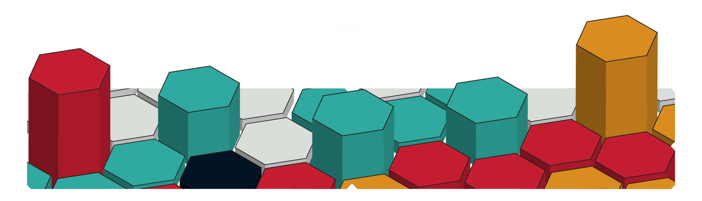

# RushLands

A fast-paced multiplayer RTS for 2–6 players. Capture buildings, build armies, and conquer enemy strongholds. Inspired by *Mushroom Wars*, with online multiplayer through Steamworks and a built-in map editor.

  

  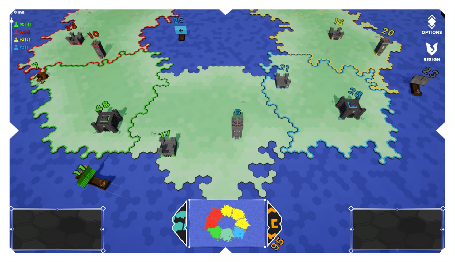

## Features

- **Multiplayer:** 2–6 players, team-based or free-for-all, with Steam lobbies and invites
- **Building control:** send units to capture and convert buildings
- **Upgrades:** defensive and production buildings have 3 upgrade levels
- **Territory system:** own an entire zone to gain passive income
- **Map editor:** build and test custom maps from inside the game lobby, with water, territories, node counts, and trade ships

## Screenshots

### Gameplay

  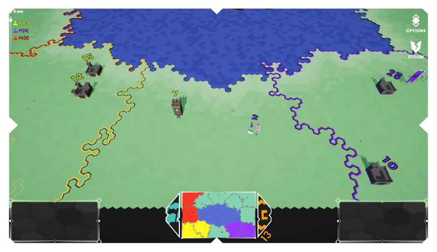
  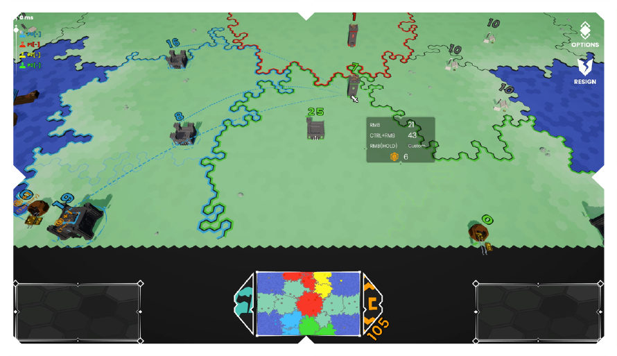

### Water Battle

  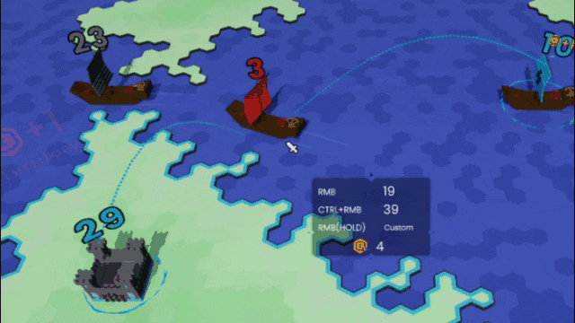
  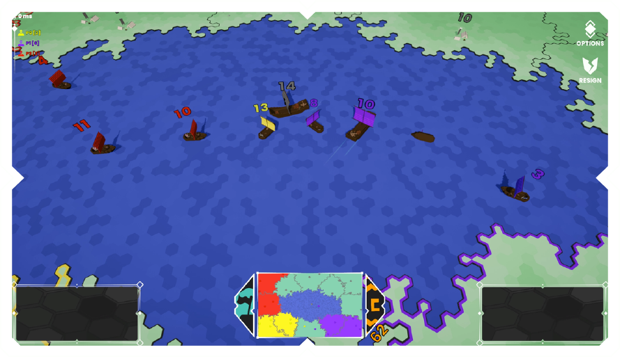

### Upgrading Buildings

  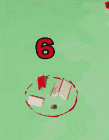
  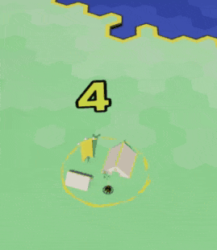

### Game Over

  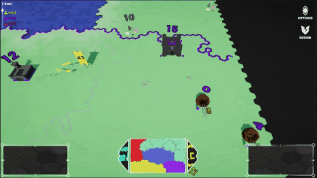

### Map Editor

  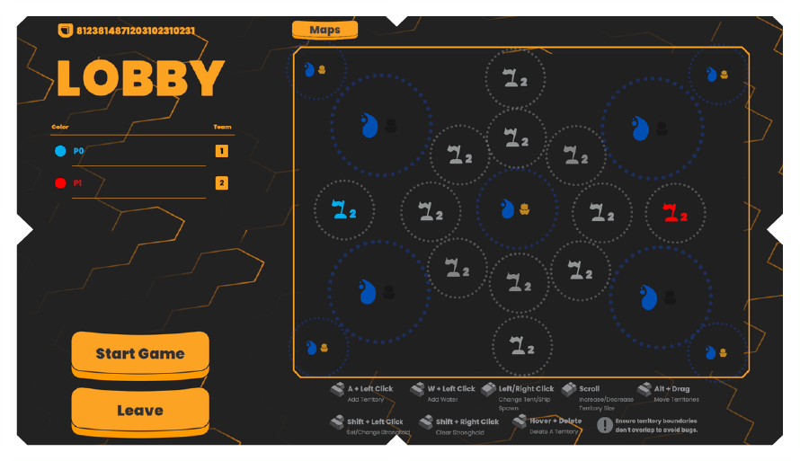
  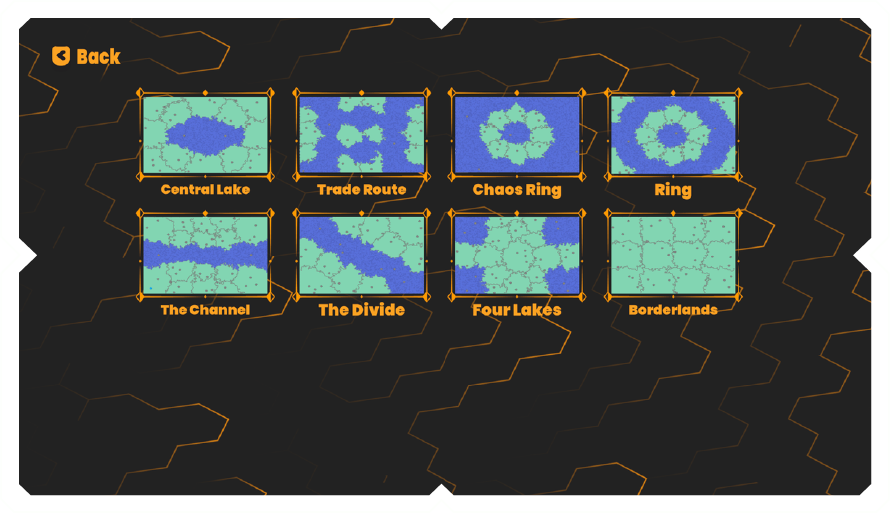

## Controls

| Action | Input |
|---|---|
| Move camera | `W` `A` `S` `D` |
| Select building | Left click |
| Box select | Click + drag |
| Multi-select / deselect | `Ctrl` + click |
| Send half of units | Right click on target |
| Send all units | `Ctrl` + right click |
| Send custom amount | Hold right click on target |
| Zoom | Scroll |

## Tech

- **Engine:** Unity (C#)
- **Networking:** Steamworks <!-- add wrapper: Steamworks.NET / Facepunch.Steamworks --> for lobbies, matchmaking and peer-to-peer play
- **Map editor:** runtime editor available in the lobby

## About this repo

This project was built in 2024. I originally kept it in **Plastic SCM** rather than Git, so this repository starts from a single snapshot of the final project and has no earlier commit history.

It was built as part of my learning journey with Unity and multiplayer networking, with the goal of making a complete RTS with matchmaking, territory mechanics, and a usable map editor.

> **Steam note:** the game uses Valve's public Spacewar App ID (480) for development. It is not an official Steam release, and is for portfolio and educational use only. Steam must be running to play multiplayer.

## Credits

- **UI design and layout:** [Arash Namaki](https://github.com/ArashNamaki)

## Author

**Sina** · [itch.io](https://drxenon.itch.io) · [GitHub](https://github.com/DrXenonn)
